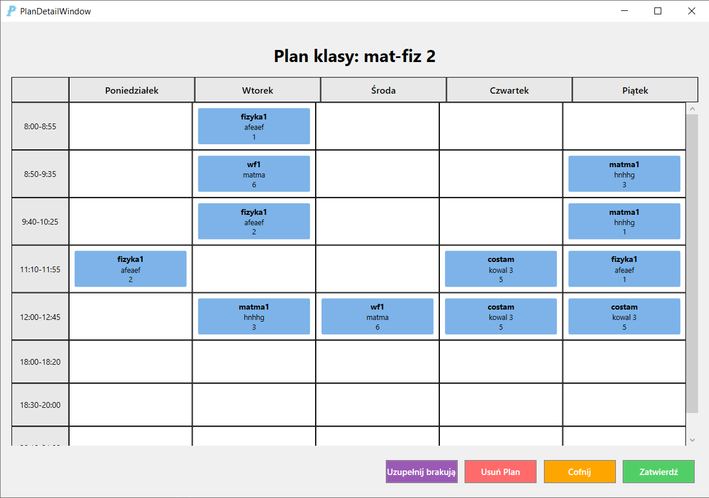
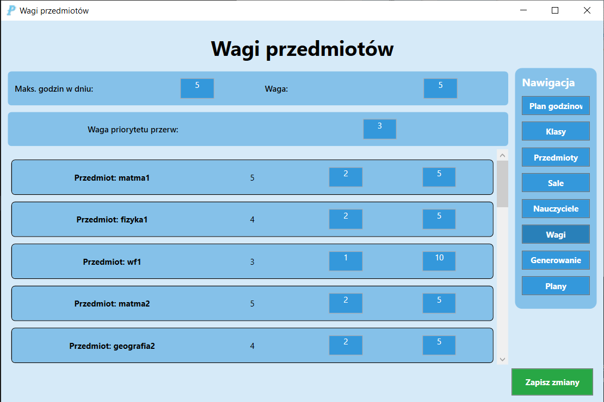
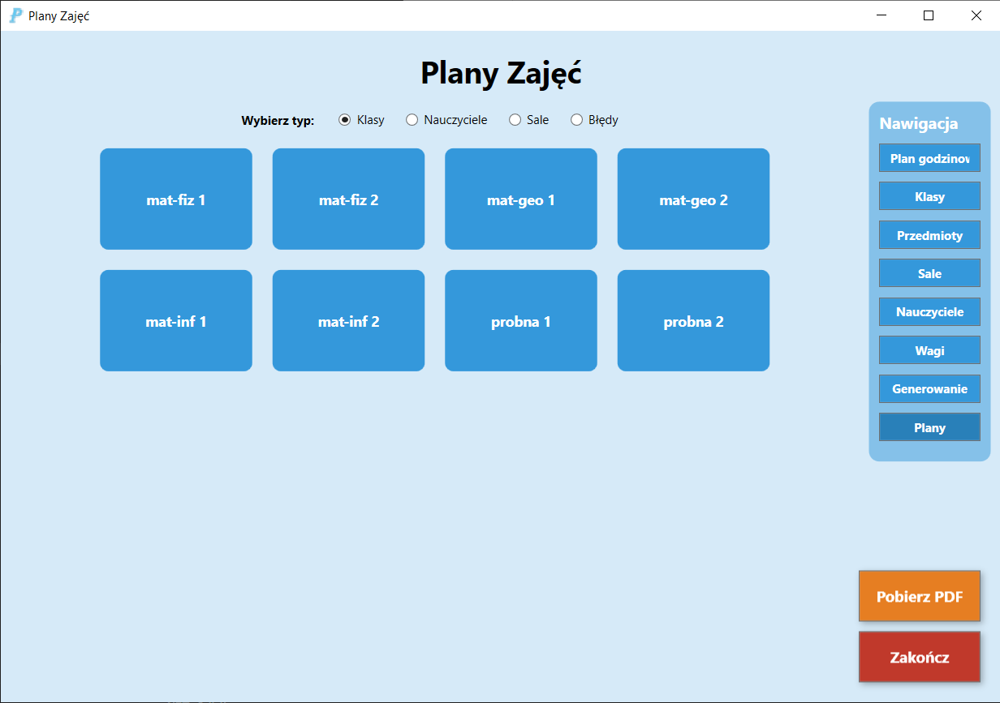

# PlanMaster

Aplikacja desktopowa, która automatycznie układa tygodniowy plan lekcji dla szkoły. Plan powstaje za pomocą algorytmu genetycznego, a program pilnuje, żeby nauczyciele, klasy i sale nie nakładały się na siebie.

Projekt powstał jako moja praca inżynierska na Wydziale Informatyki Politechniki Białostockiej.

## Co robi program

- wprowadzanie danych szkoły: klasy, przedmioty, nauczyciele (z godzinami dostępności), sale i plan godzinowy,
- ustawianie wag kar, czyli tego, na czym algorytmowi zależy bardziej, a na czym mniej,
- generowanie planu algorytmem genetycznym,
- podgląd gotowych planów dla klas, nauczycieli i sal oraz listy wykrytych błędów,
- eksport planów do PDF.

## Jak to działa

Aplikacja ma dwie części, które wymieniają dane przez pliki JSON:

- **Frontend (C#, WPF, MVVM)**: interfejs, w którym wprowadza się dane i ogląda gotowe plany,
- **Backend (Python)**: algorytm genetyczny, który dostaje dane z frontendu, szuka najlepszego planu i zwraca wynik.

### Algorytm genetyczny

- **Osobnik** to cały plan: lista lekcji, z których każda ma przedmiot, nauczyciela, klasę, salę, dzień i godzinę.
- **Populacja startowa**: 50 losowych planów, budowanych z uwzględnieniem dostępności nauczycieli i typów sal.
- **Funkcja oceny** sumuje kary za naruszenia ograniczeń. Im bliżej zera, tym lepszy plan. Kary są m.in. za:
  - nauczyciela, klasę albo salę w dwóch miejscach naraz,
  - lekcję poza godzinami dostępności nauczyciela,
  - złą liczbę godzin przedmiotu w tygodniu,
  - za dużo lekcji w jednym dniu i okienka w planie,
  - salę niewłaściwego typu.
- **Selekcja** turniejowa (k = 3), **krzyżowanie** jednopunktowe (p = 0.8), **mutacja** przesuwająca lekcję w inny termin albo do innej sali (p = 0.2).

## Zrzuty ekranu

| Ustawienia wag | Przegląd planów |
|---|---|
|  |  |

## Technologie

C# · .NET · WPF (MVVM) · Python · JSON

## Uruchomienie

Wymagania: Windows 10/11, .NET SDK, Python 3.10 lub nowszy.

1. Sklonuj repozytorium.
2. Otwórz `Inzynierka.sln` w Visual Studio albo VS Code.
3. Uruchom projekt `Frontend`. Aplikacja sama wywołuje część w Pythonie podczas generowania planu.

## Licencja

Kod jest udostępniony wyłącznie do wglądu. Szczegóły w pliku [LICENSE](LICENSE).
